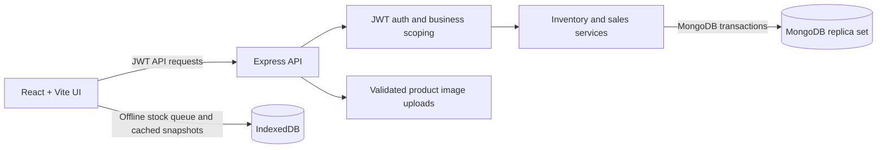

# StockWise Inventory

A business-scoped inventory and sales application built with React, Express, and MongoDB. It includes stock movement history, barcode/SKU lookup, sales, low-stock alerts, demand-based restock suggestions, reporting, staff roles, and an IndexedDB queue for offline stock operations.

## Features

- Business registration, JWT sign-in, and admin/staff role restrictions.
- Tenant-scoped products, categories, stock movements, sales, alerts, reports, and team members.
- Transaction-safe product creation, stock-in/out, multi-item sales, and returns. Stock cannot become negative, and return quantities cannot exceed the unreturned quantity of the source sale.
- Product search, category/status filters, sorting, pagination, image uploads, barcode/SKU lookup, and camera scanning where supported.
- Low-stock alerts, audit history, daily/weekly/monthly sales summaries, dashboard trends, and historical-demand restock estimates.
- Offline stock-operation queue in IndexedDB. Queued work is clearly unconfirmed until synchronized; server-side idempotency keys protect retries.

## Requirements

- Node.js 20 or newer and npm.
- MongoDB Atlas or another MongoDB deployment configured as a replica set. This application uses multi-document transactions; a standalone MongoDB server is not sufficient.
- On the development computer, the StockWise MongoDB instance can be started automatically at Windows sign-in using the per-user `StockWise MongoDB` scheduled task. It uses a separate database directory and port from any existing local MongoDB service.

## Run locally

1. Install dependencies from the project root:

   ```powershell
   npm install
   npm install --prefix backend
   npm install --prefix frontend
   ```

2. Configure the backend environment:

   ```powershell
   Copy-Item backend\.env.example backend\.env
   ```

   Set `MONGODB_URI` to your replica-set/Atlas connection string. Replace `JWT_SECRET` with a long random secret, set `CORS_ORIGIN` to the frontend origin, and keep `backend\.env` private. In MongoDB Atlas, create a database user and allow the development machine's IP in Network Access. Do not commit credentials.

3. Start both applications:

   ```powershell
   npm run dev
   ```

   The frontend is served by Vite at `http://localhost:5173`, and the API listens on `http://localhost:5000`. Open the frontend and register a business admin. The API health check is `http://localhost:5000/api/health`.

   To run either service separately, use `npm run dev --prefix backend` or `npm run dev --prefix frontend`.

   To add the optional starter catalog to an existing business, run `npm run seed:products --prefix backend -- admin@example.com`, replacing the email with that business's registered admin email. The seed is safe to rerun: existing starter SKUs are skipped. It creates categories, auditable opening-stock receipts, and a low-stock alert for the starter item below its reorder level.

## Configuration

| Variable | Purpose | Default |
|---|---|---|
| `PORT` | API port | `5000` |
| `NODE_ENV` | Runtime mode | `development` |
| `MONGODB_URI` | MongoDB replica-set connection string | Required |
| `MONGODB_MAX_POOL_SIZE` | Maximum MongoDB connection pool size | `20` |
| `JWT_SECRET` | Signing secret for access tokens | Replace the example |
| `JWT_EXPIRES_IN` | Access-token lifetime | `8h` |
| `CORS_ORIGIN` | Comma-separated allowed browser origins | `http://localhost:5173` |
| `UPLOAD_DIR` | Product image directory relative to backend | `uploads` |

## API overview

All business endpoints except health, register, and login require `Authorization: Bearer <token>`. Data is scoped to the authenticated user's business. JSON errors use a `message` field.

| Area | Routes |
|---|---|
| Health and authentication | `GET /api/health`, `POST /api/auth/register`, `POST /api/auth/login`, `GET /api/auth/me` |
| Products | `GET/POST /api/products`, `GET/PUT/DELETE /api/products/:id`, `GET /api/products/barcode/:code` |
| Inventory | `POST /api/stock/in`, `POST /api/stock/out`, `GET /api/stock/history` |
| Sales | `POST /api/sales`, `GET /api/sales`, `GET /api/sales/summary?period=daily|weekly|monthly`, `GET /api/sales/trends`, `POST /api/sales/:id/return` |
| Operations | `/api/categories`, `/api/alerts`, `/api/restocking/suggestions`, `/api/users`, `/api/dashboard`, `/api/reports`, `POST /api/sync/stock-operations` |

Stock writes and sale/return requests require an idempotency key. For stock operations, supply a unique `idempotencyKey` in the JSON body. Sales requests use `{ "idempotencyKey": "...", "items": [{ "productId": "...", "quantity": 2 }] }`. Offline synchronization accepts up to 50 operations per request.

## Architecture



## Tests and production build

```powershell
npm test
npm run build
```

Backend unit tests cover restock-demand calculations and the database-free health endpoint. Before deployment, also run the manual end-to-end checklist below against a non-production replica-set database.

For production, build MongoDB indexes as a deployment step before accepting traffic (the API disables automatic index creation in production):

```powershell
npm run db:indexes --prefix backend
```

Run this again when schema index definitions change. The command requires the same `MONGODB_URI`; it exits with an error if existing data prevents a unique index from being created.

### End-to-end checklist

1. Register two separate businesses; confirm users cannot see or modify the other business's catalog, alerts, movements, or reports.
2. Create products with opening stock; verify each opening balance has an auditable receipt movement.
3. Record stock-in, adjustment, single-item and multi-item sales; verify movement history and dashboard totals.
4. Attempt to sell more than available stock; confirm the request fails and inventory is unchanged.
5. Return part of a sale, then try returning more than the remaining quantity; confirm the excess return is rejected.
6. Lower stock to its reorder threshold, then restock; verify the alert is created and resolved accordingly.
7. Test duplicate idempotency keys and confirm retries do not duplicate stock changes.
8. Disconnect the browser, queue a stock operation, reconnect, and confirm the queued item is shown as synchronized or an actionable conflict.
9. Test barcode/SKU manual lookup and camera scanning on HTTPS or localhost in a supported browser.

## Deployment and operating notes

- The repository includes a Render Blueprint in `render.yaml`, a Vercel SPA rewrite in `frontend/vercel.json`, and a GitHub Actions workflow at `.github/workflows/main.yml`. Pushes to `main` run backend tests and build the frontend, then trigger Render and Vercel deployments.
- For the first deployment, create a MongoDB Atlas database configured as a replica set. Create a Render Blueprint from this repository and provide `MONGODB_URI` and `CORS_ORIGIN` when prompted. Use `https://<your-vercel-domain>` for `CORS_ORIGIN`; after creating the Vercel project, update this Render variable to the final Vercel domain. Disable Render automatic deployments after the first deployment so the workflow's deploy hook does not trigger a duplicate deploy.
- Create the Vercel project with `frontend` as its root directory and set the production environment variable `VITE_API_URL` to `https://<your-render-service>.onrender.com/api`. Connect the project to the same GitHub repository. The frontend is deployed by the included workflow, so disable Vercel's automatic production deployments to avoid duplicate builds.
- Add these GitHub repository Actions secrets under **Settings → Secrets and variables → Actions**. Until all required secrets for a provider are configured, its deployment job is skipped while tests and builds still run:
  - `RENDER_DEPLOY_HOOK_URL`: the deploy hook URL from the Render API service settings.
  - `VERCEL_TOKEN`: a Vercel access token allowed to deploy the project.
  - `VERCEL_ORG_ID` and `VERCEL_PROJECT_ID`: values from the Vercel project's linked `.vercel/project.json`.
- Render's Blueprint generates `JWT_SECRET` automatically. Keep MongoDB credentials and all deployment tokens in provider settings or GitHub Secrets; never commit them. After configuring the providers and secrets, push a commit to `main` or run **Actions → Test and deploy StockWise → Run workflow**.
- Use a managed replica-set MongoDB service, enable backups, and restrict database network access. Set `MONGODB_MAX_POOL_SIZE` to suit the deployment and database limits.
- Product images are stored on local disk by default. For multi-instance/ephemeral deployments, configure durable shared storage or replace local uploads with object storage before scaling horizontally.
- Render's free service may sleep when idle, so the first request after inactivity can be delayed. Registration creates the first admin for each business; staff accounts are managed by that admin.
- Offline operations are not reserved against server stock while disconnected. A queued operation may conflict after reconnection; review the reported conflict instead of assuming it was applied.
